# A Toy Model of Nonlinear Features

This project builds on *Toy Models of Superposition* [\[1\]][tms] (referred to as TMS throughout) by allowing the encoder to be nonlinear. The project is divided into three sections of toy-model results meant to serve as existence proofs of the various phenomena and a discussion meant to connect these results to the broader evidence on neural representations and computation. In [Nonlinear Representations](#nonlinear-representations), we study how depth allows the model to compress the features as nonlinear functions of the activations and visualize what that looks like. In [Tied vs. Untied Weights](#tied-vs-untied-weights), we look into the solutions that untying decoder weights allows the model to find. In [Computation in Nonlinear Codes](#computation-in-nonlinear-codes), we show two examples, one of a hand-crafted model and one of a trained network, that can do computation with features stored in a nonlinear code.

The research direction, experimental design, and summary are largely my own, but the implementation of these experiments made heavy use of coding agents (mostly GPT-6 Astra, Fable 5.1, and Opus 5.5). 

## Nonlinear Representations

### Experimental Setup

#### Data

The data exactly mirrors the setup from TMS except that we don't weight the features by importance in our main analysis. Each input is a sparse, non-negative vector with $\mathstrut n$ independent features. A feature is zero with probability $\mathstrut S$ and otherwise drawn uniformly from $\mathstrut [0, 1]$. Feature importance wasn't necessary in showing the key results.

#### Architecture

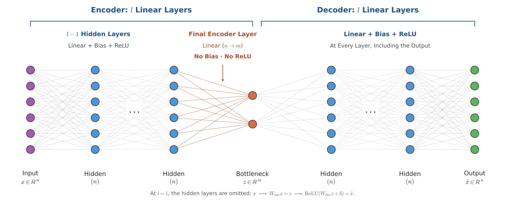

*The encoder has $`\mathstrut l-1`$ hidden layers of width $`\mathstrut n`$, each with bias and ReLU, followed by a
linear projection to the $`\mathstrut m`$-dimensional bottleneck with no bias and no ReLU. The decoder
has $`\mathstrut l`$ linear layers, each with bias and ReLU, including the output layer.*

The architecture uses untied encoder and decoder weights. The bottleneck-producing layer does not have a bias or a ReLU activation. ReLU activations would restrict the bottleneck dimensions to only take non-negative values, and a bias could be absorbed into the decoder's first bias. For $\mathstrut l=1$, this mirrors the TMS architecture but with untied weights.

#### Training

For each $\mathstrut (n, m, l, S)$ config, we train models from multiple initializations, select the model with the lowest reconstruction MSE on a fixed validation set, and the final loss we report is on a separate test set. The grid covers all 216 combinations of $`\mathstrut n \in \{16, 32, 64, 128\}`$, $`\mathstrut m \in \{2, 4, 8, 16, 32, 64\}`$ with $\mathstrut m < n$, $`\mathstrut l \in \{1, 2, 3, 4\}`$, and $`\mathstrut S \in \{0.85, 0.9, 0.95\}`$.

The training recipe uses AdamW with a peak learning rate of 0.004, 1,000 steps of warmup, cosine decay, and, for deeper models, a total step budget that grows proportional to $\sqrt{\mathstrut n}$ (the $\mathstrut l=1$ models use a fixed 8,000 steps). We use `weight_decay=0.01` (on weight matrices only, not biases), and `batch_size=8192`. We start with training the $\mathstrut l=1$ models and then use the trained $\mathstrut l=1$ models as "warm start" initializations for the $\mathstrut l=2$ models and so on (using identity matrices as "padding"). For each config, we try multiple warm starts and random initializations and select the best one.

An important observation is that the loss should be monotonically decreasing with decreasing $\mathstrut n$ (less compression), increasing $\mathstrut m$ (more space to compress), increasing $\mathstrut l$ (more expressive model), and increasing $\mathstrut S$ (fewer features active per data point). After each round of training, we search for any of these monotonicity violations and retrain that config with more initializations (both "warm starts" and random). In general, optimization of heavily bottlenecked networks is tricky, but the combination of warm starts, many initializations, and looking for monotonicity violations somewhat addresses the difficulty.

The training code is in `src/` and `scripts/`.

### Analysis

#### Mean Squared Error Across the Sweep

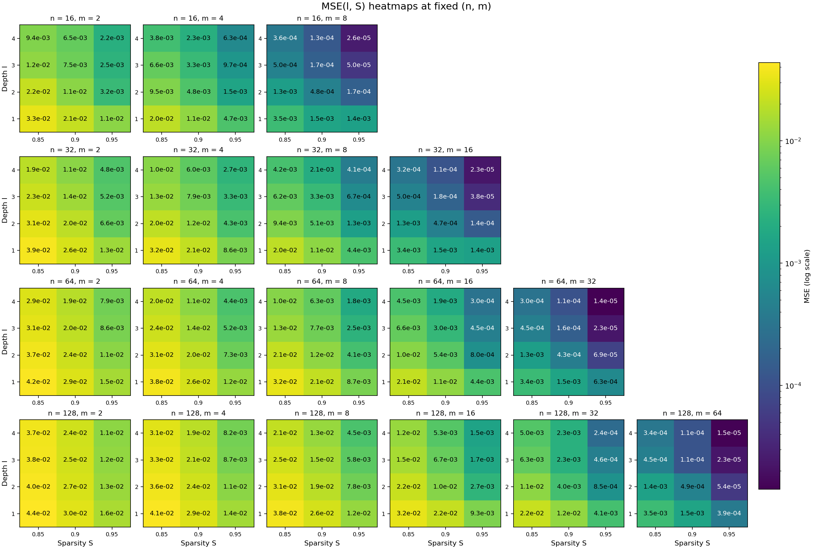

*This view shows the loss of every $`\mathstrut (n, m, l, S)`$ config. Each panel describes a given $`\mathstrut n`$, $`\mathstrut m`$ combination, and $`\mathstrut l`$ and $`\mathstrut S`$ vary within each panel. The number of features $`\mathstrut n`$ increases as you go down the rows of panels, and the bottleneck dimension $`\mathstrut m`$ increases as you go across to the right. Within each panel, depth $`\mathstrut l`$ increases upward and sparsity $`\mathstrut S`$ increases as you move to the right. The MSE is averaged over both features and data points.*

As expected after the monotonicity retraining described above, the loss is monotonic in all four dimensions. The axes have been organized such that going up and to the right decreases loss.

#### Scaling Law

We fit the following curve to reconstruction error:

$$
\large \mathrm{MSE} = \frac{\mathstrut V(S)}{\mathstrut 1 + A_l\hspace{0.17em}\left(e^{c_{l,S}\hspace{0.17em}r} - 1\right)}
$$

$$
\large r = \frac{m}{(1-S)\hspace{0.17em}n}, \qquad V(S) = \frac{1-S}{3} - \frac{(1-S)^2}{4}
$$

There are a few notable pieces of this functional form. We use $\mathstrut r$ to denote the bottleneck dimensions per expected active feature and it is a measure of compression or "rate" (from rate-distortion theory). Asymptotically, the loss is exponentially decreasing in $\mathstrut r$ as is standard in rate-distortion theory. We treat rate-distortion as a motivating framing, but it does not directly apply. In a rate-distortion sense, our true rate would be the full number of bits in our floating-point numbers in the bottleneck, and with this rate, we should be achieving a much lower distortion (loss). However, these codes would be very impractical for a neural network to learn via gradient descent.

At $\mathstrut r=0$, we are allowed no information in the bottleneck and our best guess of the value of each feature is its mean. The loss at $\mathstrut r=0$ would therefore be $\mathstrut V(S)$, the variance of one feature, and the functional form requires this.

At $\mathstrut A_l=1$, the functional form is exactly exponential. At $\mathstrut A_l < 1$, the functional form is logistic. For $\mathstrut A_l > 1$, the relative decay rate starts at $\mathstrut A_l\hspace{0.17em}c_{l,S}$ and shifts toward $\mathstrut c_{l,S}$ as $\mathstrut r$ increases. To see why, differentiating $\mathstrut -\log(\mathrm{MSE})$ with respect to $\mathstrut r$ gives

$$
\large -\frac{\mathstrut d}{\mathstrut dr}\hspace{0.17em}\log\left(\mathrm{MSE}\right) = \frac{\mathstrut A_l\hspace{0.17em}c_{l,S}\hspace{0.17em}e^{c_{l,S}\hspace{0.17em}r}}{\mathstrut 1 + A_l\left(e^{c_{l,S}\hspace{0.17em}r}-1\right)}
$$

At $\mathstrut r=0$, the exponential and denominator both equal 1, leaving $\mathstrut A_l\hspace{0.17em}c_{l,S}$. As $\mathstrut r$ grows, the exponential terms in the numerator and denominator both come to dominate and we can see that everything cancels except $\mathstrut c_{l,S}$:

$$
\large \frac{\mathstrut A_l\hspace{0.17em}c_{l,S}\hspace{0.17em}e^{c_{l,S}\hspace{0.17em}r}}{\mathstrut 1-A_l + A_l\hspace{0.17em}e^{c_{l,S}\hspace{0.17em}r}} \sim \frac{\mathstrut A_l\hspace{0.17em}c_{l,S}\hspace{0.17em}e^{c_{l,S}\hspace{0.17em}r}}{\mathstrut A_l\hspace{0.17em}e^{c_{l,S}\hspace{0.17em}r}} = c_{l,S}.
$$

For each depth, we fit one $\mathstrut A_l$ shared across sparsities and a separate
$\mathstrut c_{l,S}$ for each sparsity, minimizing squared error in log MSE.

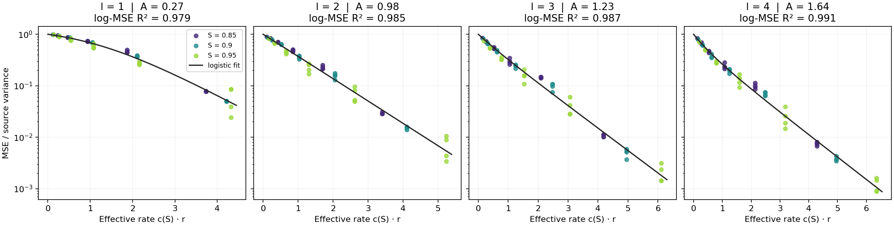

*Each panel shows one depth. Points are colored by sparsity; the horizontal coordinate is
rate multiplied by that sparsity's fitted $`\mathstrut c_{l,S}`$.*

The fitted $\mathstrut A_l$ values are:

| Depth $\mathstrut l$ | Shape $\mathstrut A_l$ | Log-MSE $\mathstrut R^2$ |
|---|---:|---:|
| 1 | 0.273 | 0.979 |
| 2 | 0.982 | 0.985 |
| 3 | 1.226 | 0.987 |
| 4 | 1.643 | 0.991 |

The fitted  $\mathstrut c_{l,S}$ coefficients from the same fit are:

| Depth $\mathstrut l$ | $\mathstrut c_{l,0.85}$ | $\mathstrut c_{l,0.90}$ | $\mathstrut c_{l,0.95}$ |
|---|---:|---:|---:|
| 1 | 1.121 | 0.843 | 0.432 |
| 2 | 1.023 | 0.823 | 0.524 |
| 3 | 1.253 | 0.991 | 0.612 |
| 4 | 1.284 | 0.992 | 0.636 |

We can see that the fitted $\mathstrut A_l$ increases with depth, which captures part of how deeper models make better use of the information allowed
by the bottleneck (the full story of course depends on $\mathstrut c_{l,S}$).

Increasing sparsity lowers loss both by lowering $\mathstrut V(S)$ and by raising $\mathstrut r$ because fewer features are active. However, the fitted
$\mathstrut c_{l,S}$ decreases with sparsity, partially offsetting this. One interpretation is that since sparser inputs lower variance by concentrating more mass on zero but still having the same maximum value, it could be harder to produce the same level of relative loss decrease as compared to the world where the initial variance reduction came from scaling all inputs down by some factor.

There is also a dependence of $\mathstrut c_{l,S}$ on depth. There is some weirdness of it decreasing from $\mathstrut l=1$ to $\mathstrut l=2$ at two of the sparsities which I mostly attribute to interaction with $\mathstrut A_l$ because $\mathstrut A_l$ increases a lot from $\mathstrut l=1$ to $\mathstrut l=2$. Besides that, we see that the various $\mathstrut c_{l,S}$ coefficients increase with depth, which captures the other piece of how deeper models make better use of a given bottleneck.

#### m = 2 Visualizations

For $\mathstrut m=2$ configs, we can visualize the bottleneck dimension directly. The following three methods each provide a unique view on how a model could represent and then decode features in a nonlinear way:

- **Feature trajectories** - Let $\mathstrut z(x)$ denote the encoder's output for input $\mathstrut x$, and $\mathstrut e_i$ be the one-hot vector for feature $\mathstrut i$. We trace how a single feature is encoded in the bottleneck $\mathstrut z(t\cdot e_i)$ as its magnitude $\mathstrut t$ increases from 0 to 1 while the other features remain zero. A single linear encoder would give straight, constant-speed rays, but deeper encoders can change both the direction and speed of these trajectories.

- **Feature speeds** - The middle row shows the speeds of the trajectories, $\mathstrut \lVert dz(t\cdot e_i)/dt\rVert_2$, versus input value $\mathstrut t$, on a log scale. The model uses a variety of speeds to move features away from each other. We can see that for $\mathstrut l=2$, several features have very low speeds. It's possible that the shallower model didn't have the capacity to try to represent all 64 features and those are features it gave up on.

- **Decoder regions** - An alternative view of the bottleneck dimension comes from the decoder's perspective. We color the plane by the feature with the largest reconstructed value at each point. Other features can also have substantial reconstructed values in the same region. 

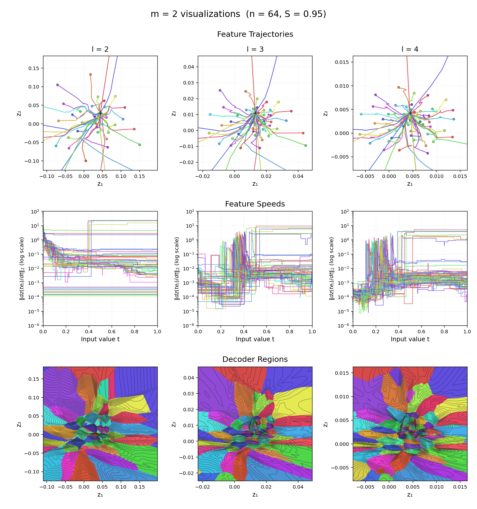

*Top: trajectories for all 64 features, with dots at $`\mathstrut t=1`$ and a cross at $`\mathstrut z(0)`$. 
Middle: feature speeds over the input interval, with a shared logarithmic speed scale on the y-axis.
Bottom: decoder regions and contours connecting points of equal decoder L2 magnitude. 
All panels use $`\mathstrut n=64`$, $`\mathstrut m=2`$, $`\mathstrut S=0.95`$. The same feature has the same color in all three rows. The top and bottom panels share a square zoom around $`\mathstrut z(0)`$ within each column. The scales of the first and third rows differ across depths.*

If you look at feature trajectories and decoder regions simultaneously, you can see how the features get moved by the encoder into the regions where the decoder is looking to find them. Furthermore, if you look at feature speeds, it seems like many features speed up to get to "their region" and then slow down.

At one point, we considered an encoder without biases. This seemed too restrictive because a bias-free ReLU encoder $\mathstrut z(x)$ is positively homogeneous: $\mathstrut z(t\cdot x) = t\cdot z(x)$ for $\mathstrut t \ge 0$. Every feature trajectory $\mathstrut z(t\cdot e_i)$ is a straight ray.

## Tied vs. Untied Weights

The models above differ from TMS in both depth and weight tying. Here we isolate untying at $\mathstrut l=1$, which lets the model write a feature into the bottleneck along one direction and read it back along another.

### How Untying Helps

We can see some of the tricks an autoencoder can use with untied weights by directly visualizing the following model with $\mathstrut l=1$, $\mathstrut n=5$, $\mathstrut m=2$, and $\mathstrut S=0.9$. In this example, untying reduces MSE by about 40%.

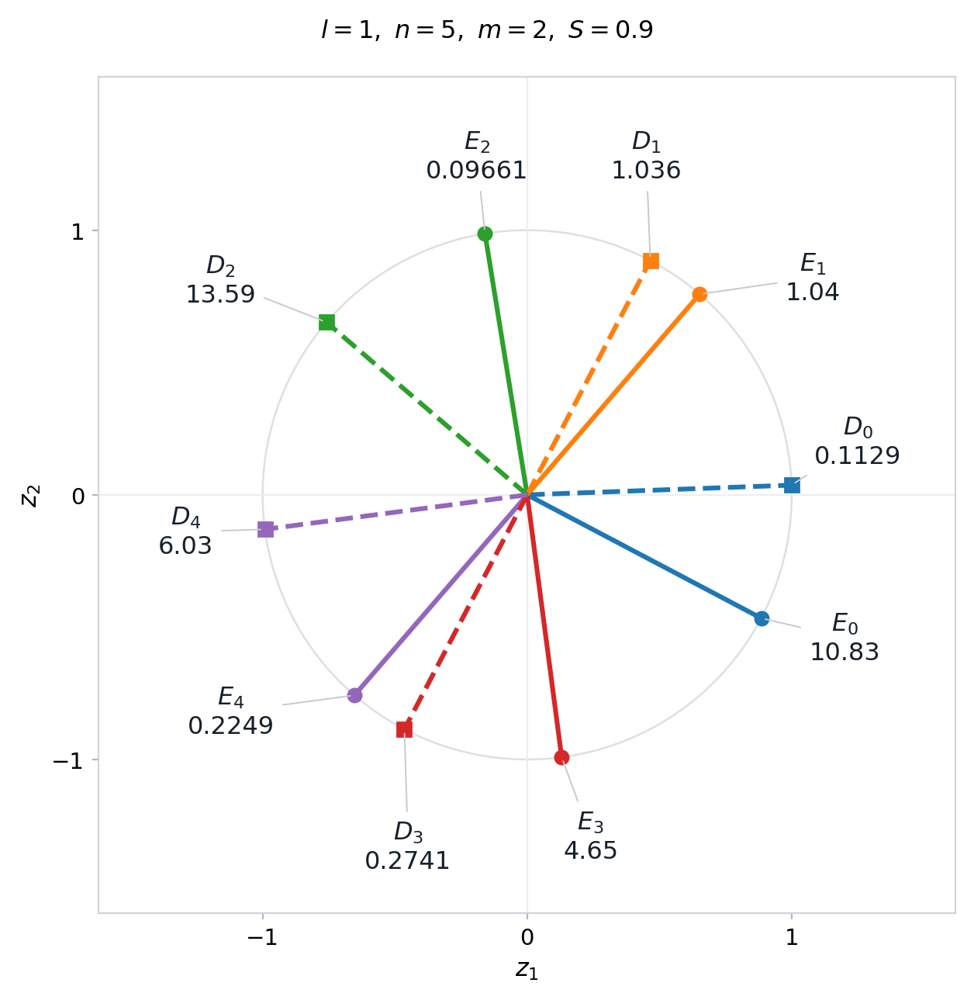

*Solid E vectors are encoder/write directions and dashed D vectors are decoder/read directions. Colors match features, numbered 0–4. The vectors only represent directions and labels show the magnitudes.*

#### 1. Separating Read and Write Directions

To limit interference, write vectors only need to avoid other features' read vectors, and read vectors only need to avoid other features' write vectors. For example, $\mathstrut E_0$ has near-zero dot products with $\mathstrut D_1$ and $\mathstrut D_3$, despite much larger dot products with $\mathstrut E_1$ and $\mathstrut E_3$. This allows $\mathstrut E_1$ and $\mathstrut E_3$ to move away from the decoder vectors on the upper left half of the circle. This works in combination with trick 2 to avoid too much interference between $\mathstrut E_1$ and $\mathstrut D_0$.

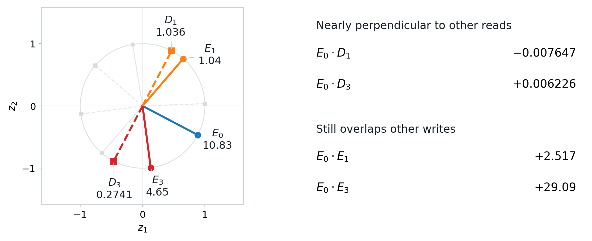

#### 2. Trading Off Read and Write Magnitudes for Nearby Features

For a tied model, a feature's own response is its vector's squared length, so keeping that response near 1 also forces the length to stay near 1. Untied models get to use feature magnitude to their advantage. $\mathstrut E_4$ and $\mathstrut D_3$ point in nearly the same direction, but their small magnitudes keep their dot product low. Their partners $\mathstrut D_4$ and $\mathstrut E_3$ are large enough to keep each pair's dot product near 1, but they are essentially perpendicular to each other.

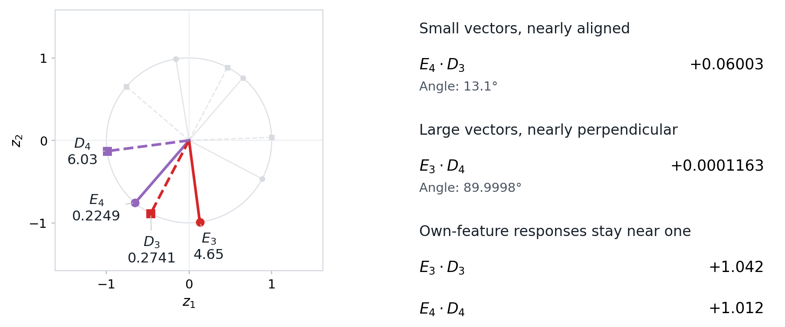

#### 3. Making Negative Interference Asymmetric

This is another way that untied models use magnitude differences, but this time it applies to two features pointing in opposite directions rather than two nearby features. $\mathstrut D_2$ reads large negative interference from $\mathstrut E_0$, while $\mathstrut D_0$ reads almost nothing from $\mathstrut E_2$. When both features fire, feature 0 can still be reconstructed even if feature 2 is suppressed, whereas tying would force equal interference both ways. High sparsity makes this simultaneous interference less frequent, but it still has some cost. One way to think about it is if you knew that two dipole-esque features were firing, where would you want to place $\mathstrut z(x)$? Placing it symmetrically near the origin just makes it impossible to read either, so you might as well pick a side and get one right (and the other gets negative interference that gets clipped to zero).

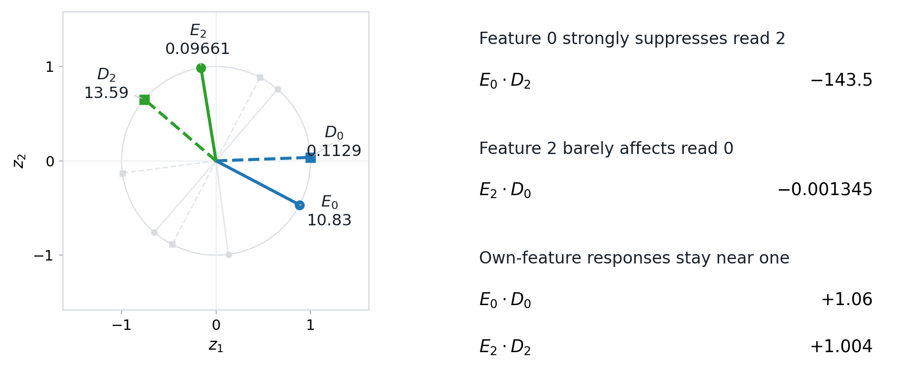

### Weight Norms and Regularization

One aspect of this untied toy model is that it uses large weight magnitudes to pull off its tricks. It's easy to see how regularization through weight decay could diminish the advantage of untying. To study this, we take the same model studied above and apply increasingly strong weight decay.

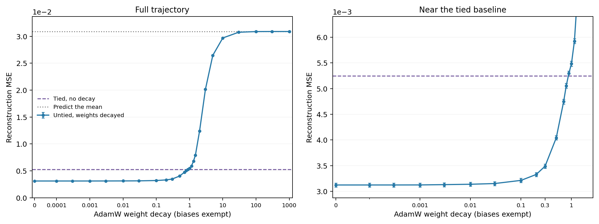

*The same $`\mathstrut l=1`$, $`\mathstrut n=5`$, $`\mathstrut m=2`$, $`\mathstrut S=0.9`$ model, with decay applied to weights and not biases.*

In our weight-decay sweep, we see that by $\mathstrut \lambda = 1$ the advantage of untying is gone, and by $\mathstrut \lambda = 100$, the model is essentially guessing the mean. Very roughly speaking, $\mathstrut \lambda$ caps individual weight coordinates at $\mathstrut \sim 1/\lambda$ [\[2\]][adamw-bias]. Since the unrestricted optimum used weights up to around norm 10, decay doesn't interfere with the learned optimum significantly until around $\mathstrut \lambda = 0.1$. Around $\mathstrut \lambda = 1$, the model has to have weights of around norm 1 and its tricks stop working. We can get some intuition for this by investigating the case where we explicitly normalize either the encoder or decoder weights to unit length.

When we fix either all reads or all writes to unit length, this seems to entirely remove untying's advantage. If reads are unit norm, a write can lean away from one read, but there is no smaller read to lean toward. The same applies with reads and writes reversed. The best solutions in our one-sided normalization experiments have nearly aligned reads and writes and essentially the same MSE as tied models.

### Connection to the Asymmetric Superposition Motif

In TMS, the authors describe a phenomenon called the asymmetric superposition motif that has very similar properties to the relationship between feature 0 and feature 2 in our untied-weights example. Specifically:

1. **Reciprocal weights** - feature 0 has a very large encoder magnitude and small decoder magnitude, and feature 2 has the reverse.
2. **Asymmetric interference** - feature 0 strongly suppresses feature 2 but feature 2 barely affects feature 0.
3. **Negative interference** - the interference from feature 0 to feature 2 is very strong but it can be clipped to 0 by the ReLU. It still suppresses feature 2 if they are simultaneously active, but reconstruction is nearly perfect if just one of the two features is active.

There are some differences as well:
1. **Computation vs. Representation** - In that section, the toy model was doing the computational task of computing $\mathstrut \lvert x\rvert$ rather than a purely representational task.
2. **Hidden-layer ReLUs** - Their toy model used ReLUs in the hidden layer, not just the output layer.
3. **Inhibitory neuron** - Since the hidden layer was restricted to non-negative activations due to the ReLU, the TMS model could not get negative interference via a dipole. Instead, it created this negative interference through a separate inhibitory neuron with large negative output weights. 

### Replicating the Toy Models of Superposition Pentagon

As a sanity check for our tied-weight models, we reproduce the pentagon result from TMS, with tied weights and feature importance $\mathstrut 0.7^i$, at $\mathstrut l=1$, $\mathstrut n=5$, $\mathstrut m=2$, $\mathstrut S=0.95$.

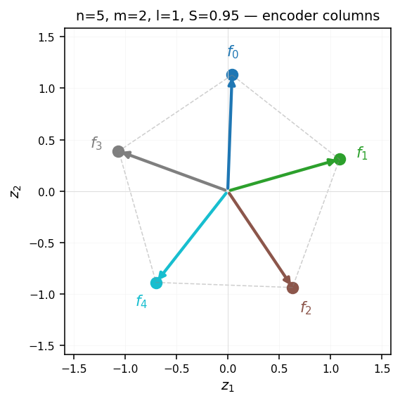

*Model saved at `results/tied_untied/pentagon_n5_m2_l1_S0.95.pt`.*

## Computation in Nonlinear Codes

We've shown that a model can store and recover features using nonlinear encoding and decoding schemes. But models tend to do more than store information; they also compute algorithms. We give two existence proofs of models that compute with features stored in a nonlinear code without first recovering them. We start with a handwritten example and then train a small network to do something similar.

### A Small Handwritten Example

The following model encodes two Boolean bits into a single scalar $h$ using a nonlinear function and then computes their XOR without first representing both of the bits linearly.  

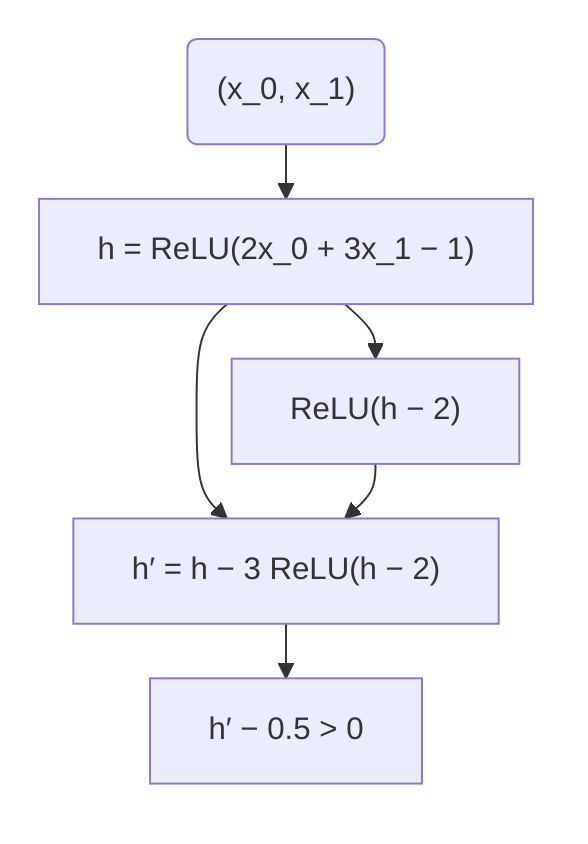

*Arrows are dependencies and each node shows its computation. The final node computes XOR.*

The following table shows the computation that the model does for each of the four possible inputs.

| Input $(x_0, x_1)$ | Code $h$ | Updated code $h'$ | XOR |
|---|---:|---:|---:|
| `(0,0)` | 0 | 0 | 0 |
| `(1,0)` | 1 | 1 | 1 |
| `(0,1)` | 2 | 2 | 1 |
| `(1,1)` | 4 | -2 | 0 |

We consider this an example of computation in a nonlinear code due to the following two criteria:

1. **Nonlinear encoding** - The model compresses the inputs into a nonlinear representation before computing XOR. We consider three subcriteria:

   a. The number of bottleneck dimensions is smaller than the number of features. In this case, since we only have two features, we use a scalar bottleneck.

   b. No affine formula $w_0x_0 + w_1x_1 + b$ can reproduce the bottleneck:

    - At `(0,0)`, the output is 0, so $b=0$.
    - At `(1,0)`, the output is 1, so $w_0=1$.
    - At `(0,1)`, the output is 2, so $w_1=2$.

      The only possible affine formula is therefore $h = x_0 + 2x_1$. But at `(1,1)` it gives 3, while our encoder gives 4, so no affine formula matches all four inputs.
      
   c. Both bits could be extracted with a nonlinear decoder, which we can see since $h$ is a distinct number for each input. In the following trained example, we will also show a particular trained nonlinear decoder does indeed recover the initial features.

2. **Computation in the nonlinear code** - The model computes XOR using the nonlinear code without first recovering the inputs linearly. We again consider three subcriteria:

    a. The model successfully computes XOR on all four inputs $`(x_0, x_1) \in \{0, 1\}^{2}`$.

    b. The compression into $h$ is not doing the computation. We can see that XOR initially occupies the middle two values of $h$, so no single threshold could read it.

    c. The model does not recover both inputs. One of the operands, $x_0$, cannot be identified by any affine function followed by a threshold on the joint state $(h, \mathrm{ReLU}(h-2))$. The $x_0=1$ point `(1,0)` lies between the $x_0=0$ points `(0,0)` and `(2,0)`, so no line could separate the line segment defined by $x_0=0$ and the line segment defined by $x_0=1$. The other operand $x_1$ is linearly readable in $h$ with the threshold 1.5. This is unavoidably true for one of the two inputs if we require that $h$ does not compute XOR. Imagine splitting $h$ into its smallest two and largest two values. The split will either be given by $x_0$, by $x_1$, or by XOR.
   
Two extra properties of this example make it somewhat more compelling, but we don't consider these necessary. 

1. Both bits of information remain preserved. Since each pair maps to a distinct $h'$ value, a nonlinear decoder could still recover both inputs.

2. Using two ReLUs is minimal for this demonstration. One is needed to make the initial encoding non-affine, and another is needed to make the XOR linearly readable. Since we require that XOR is not linearly readable in the initial encoding, we can't just do one ReLU.

A couple of things make this example somewhat less compelling. One is that $h$ is kind of an "OR-ish" feature and $\mathrm{ReLU}(h-2)$ is basically "AND". We could say that the network is merely calculating the natural features "OR" and "AND", representing those linearly, and then doing calculation in that space. Also, we could've used a linear encoding for $h$ and computed XOR like $`x_0 + x_1 - 2\,\mathrm{ReLU}(x_0 + x_1 - 1)`$.

### A Trained Example

Can a network learn the same sort of computation? This time, we use four Boolean bits, compress them into two coordinates, and ask for $(x_0 \oplus x_1,\ x_2 \oplus x_3)$. We train and evaluate on all 16 inputs with equal weight.

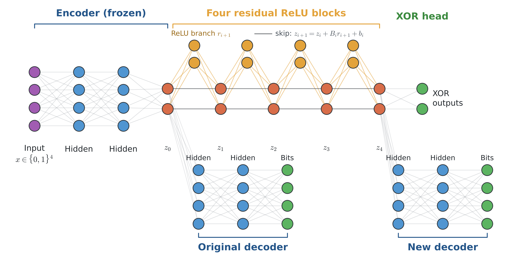

*The encoder and decoders use ReLU in their hidden layers and linear outputs. All linear layers have biases.*

Training has three stages. First, we train the autoencoder only on reconstruction. Then, we freeze it and train the residual blocks and XOR head. Finally, we train a new decoder jointly with the residual blocks and XOR head, using $\text{XOR loss} + \beta \cdot \text{reconstruction loss}$, with mean binary cross-entropy for both terms. This lets the circuit adjust for reconstruction while penalizing mistakes on XOR. The example above uses $\beta = 1$, with the circuit learning at 1/100 of the decoder's rate. The encoder stays frozen, so it never learns from XOR labels.

Each residual block computes:

$$
r_{i+1} = \mathrm{ReLU}(A_i z_i + a_i), \qquad z_{i+1} = z_i + B_i r_{i+1} + b_i
$$

Following the checklist from the handwritten example:

1. **Nonlinear encoding**

   a. The model uses 2 bottleneck dimensions for 4 features.

   b. The model's encoder cannot be reproduced linearly. We can check that $z(1,1,0,0) \neq \big(z(1,0,0,0) - z(0,0,0,0)\big) + \big(z(0,1,0,0) - z(0,0,0,0)\big) + z(0,0,0,0)$. For this model, the linear formula gives `(-0.118, -1.433)` while the trained encoder gives `(-0.124, -1.604)`. More generally, the best affine fit to all 16 codes misses them by about 0.41 on average, roughly ten times the distance between the two closest codes.
   
   c. All 16 inputs are perfectly reconstructed by the nonlinear decoder in the first training stage.

2. **Computation in the nonlinear code**
   
   a. The model successfully computes both XORs on all 16 inputs.
   
   b. Neither XOR is linearly readable before the residual blocks. We check that XOR = True and XOR = False define intersecting convex hulls for both XOR functions by checking that some convex combination of XOR = True points equals a convex combination of XOR = False points.
   
   c. One input per XOR, $x_1$ and $x_2$, never becomes perfectly linearly readable at any residual block, even when we read the state and its ReLU branch together. This is also verified with intersecting convex hulls.

For the second XOR, the end of the network does something like the handwritten example's "OR-ish" minus "AND-ish" algorithm, with one input handled as something of a special case. For the first XOR, it does not seem like the algorithm can be decomposed that cleanly. 

### How Often Training Finds This Kind of Solution

| Stage | Attempts and results |
|---|---|
| Initial autoencoder | 2/10 seeds (best of 3 restarts each) reconstructed all 16 inputs. |
| XOR training | 51/128 seeds trained on those two encoders solved both XORs. Of those, 48 had two persistently linearly unreadable bits and 3 had one. Of those 48, 13 kept an operand of each XOR persistently unreadable. |
| Joint training | Reusing those 13 circuits with 32 decoder initializations per circuit gave us 416 attempts, and 3/416 satisfied all requirements.|

Overall, it was pretty difficult to get the autoencoders to work, which is consistent with the difficulty of training the highly bottlenecked autoencoders in the first section (needing many seeds, warm starts, etc.). However, it was surprisingly common to get networks that did not linearly represent the bits.

## Discussion

### Related Work

This project directly builds on Elhage et al. [\[1\]][tms]. The representation and computation sections are direct analogues to representation in superposition and computation in superposition. As mentioned above, some of the Tied vs. Untied Weights section echoes the asymmetric superposition motif. Most importantly, TMS builds one possible model of the Linear Representation Hypothesis (LRH) where features, semantically meaningful units of representation, are both encoded and decoded with vectors in activation space. A later note in the Transformer Circuits Thread [\[3\]][olah-linear] adds that the LRH can be extended to multidimensional representations as long as those also scale with intensity and compose additively. Despite the name of this project, I largely agree with the LRH, and it certainly has a lot of explanatory power. TMS also makes some direct comments about nonlinear features. It suggests the following nonlinear compression scheme as a possibility:

$$
\large t = \lfloor Zx \rfloor + \frac{\mathstrut y}{\mathstrut Z}
$$

It packs two features $\mathstrut x, y \in [0, 1]$ into a single number $\mathstrut t$. While our models did not represent this function, this theoretical encoding scheme shares some properties with the empirical ones in this work. In particular, the TMS authors noted that models would need to replace the discontinuities with steep linear segments. In general, the more nonlinear models in this project needed to use larger weights, and were therefore more sensitive to small perturbations. This tradeoff of compression and robustness is noted in the adversarial examples section of TMS. The nonlinear models in this project can double down on this tradeoff because of the lack of either distributional shift or adversarial inputs.

TMS also included some skepticism about nonlinear features. I broadly share this skepticism, but I think that this work provides some important caveats. They laid out their skepticism in three points:

1. **The model needs to decompress features before it can compute with them naturally.** I think this is largely true. It is natural to represent features linearly in the residual stream so that every MLP or attention layer can easily read them. It is natural to be able to add unrelated features together, or to have multiple components feed into a feature without it then spilling over into meaning something else. However, I think that the Computation in Nonlinear Codes section provides at least some evidence that it is in theory possible to compute with features while they are compressed in a nonlinear code and that a neural net can learn this.

2. **Nonlinear features are difficult to learn.** Again, this seems largely true. In our experiments, we needed many seeds and warm starts to find good solutions. Partly this was due to how bottlenecked the networks were, but, if larger networks use nonlinear representations, it is likely because they are similarly bottlenecked. Still, it was possible to learn such networks. Linear features, on the other hand, do seem much easier to learn. In *What Would Non-Linear Features Actually Look Like?* [\[4\]][gorton], Gorton notes that with linear reads, every earlier component contributing to a feature can learn to point along that linear read, without coordinating with other components.

3. **They take enough neurons that the benefit over superposition isn't worth it.** Gorton agrees, and highlights the same issue of MLP capacity. 

On top of these arguments, I would add that LayerNorm seems to make magnitude superposition (features primarily discerned using magnitude rather than direction) harder. In order to use magnitude to convey information for one feature, you may make other features less salient. This also happens for linear features when a feature has high magnitude, but it works in the way you'd expect if magnitude corresponds to salience as opposed to encoding other feature identification information. 

In the aforementioned blog post, Gorton highlights some additional points, and, again, I largely agree. Gorton asserts that nonlinear reads are more likely in capacity-starved models, and this project elicits nonlinearity specifically through intentionally capacity-starved models. Gorton also notes that write nonlinearity is a crux, and that she expects write nonlinearity to be uncommon. Indeed, we found that it was trickier to get write nonlinearity than read nonlinearity. As noted earlier, the handwritten example's nonlinear encoding could have been replaced by a linear one. Also, our trained networks tended to be more read-nonlinear than write-nonlinear. Still, I think we provide a story for nonlinear writes that we see in the $\mathstrut m=2$ visualizations. When the network wants to use a region rather than a direction, we can see a feature "speed up" to get to its region and then "slow down" once it's there, but I would not claim that I expect this behavior to be very common or salient in typical networks. 

Setting aside some of the technical details, there is a sentiment behind this piece that I agree with. Gorton notes that she had repeatedly encountered nonlinear features as an objection to mechanistic interpretability work, and that this post was a response to that. While I would add more caveats to the LRH arguments than Gorton does, I share the belief that nonlinear features are a weak objection to the project of mechanistic interpretability as a whole. There have been many interpretability successes on the back of the LRH, and I would expect more to come. Furthermore, to the extent that nonlinear features may occur, I believe in the field's ability to discover and understand them, and I see this project as part of that effort.

Csordás et al. [\[5\]][rnn] identify a form of magnitude superposition, which they call "onion representations", in capacity-constrained RNNs. These networks were somewhat less capacity constrained than our models and also their recurrent structure led to a natural "unpacking" algorithm. As Gorton notes, the features are actually read-linear at the time they are accessed. 

In *Into the Rabbit Hull*, Fel et al. [\[6\]][rabbit-hull] put forward the "Minkowski Representation Hypothesis" or MRH. The idea here is that one should consider "archetypal points" in the space rather than "directions" as the atomic unit of semantic meaning. From the authors' perspective, this explains the empirical result that steering with a linear direction works up to a point, plateaus, and then decays. From a certain view, this can be seen as both a write nonlinearity and a read nonlinearity. When writing a feature with increasing magnitude, you get closer to some point but then have to slow down or stop scaling eventually. When reading a feature, if the residual stream is in a state "past" a particularly archetypal point, reading linearly would imply there's a lot of that feature but there's actually less than if you were right at the archetypal point. Furthermore, this implies that "steering toward concept x" should be dependent on the current state rather than a constant direction. Still, this all seems roughly consistent with an LRH interpretation. Steering plateauing and then decaying could instead be described as the LRH holding until you break the model by going off distribution. The LRH also somewhat predicts state-dependent steering because steering with `feature_x - sum(other_features)` looks more like concept x than just steering with `feature_x` alone. 

This project also connects to a lot of work on "manifolds". Engels et al. [\[7\]][engels] sparked discussion on the distinction between nonlinear features and multidimensional features, as noted in the July 2024 circuits thread update [\[3\]][olah-linear]. The paper found several concepts, including days of the week, that are inherently multidimensional. If you considered each day of the week to be its own feature, you could get nonlinear results such as Monday + Wednesday = Tuesday, but if you considered the entire concept as a unit it may compose linearly with other features. Gurnee et al. [\[8\]][counting] identified manifolds Claude 3.5 Haiku uses to predict upcoming linebreaks (e.g., character count) that could either be described as a family of discrete features or as a single 1D feature manifold curving through a multidimensional subspace. Again, in the view involving a family of discrete features, these features do not compose well linearly but, when viewed as a manifold, this (maybe?) composes linearly with other features. Bhalla et al. [\[9\]][sae-geometry] find manifolds via an Ising model on SAE features. In separate work, Fel et al. [\[10\]][bsf] train block-sparse featurizers (BSFs), a decomposition method that is manifold-aware from the start rather than post hoc. This automates finding subspaces with these manifolds by enforcing sparsity among manifolds but not within manifolds. BSFs do not attempt to learn the nonlinear structure within these subspaces but rather stay content with using a linear coordinate system for the manifold. Luo et al. [\[11\]][metamodel] attempt to learn nonlinear manifold structure with diffusion methods but don't assume any block-sparse generative model. Shafran et al. [\[12\]][mfa] decompose activations into regions rather than directions, fitting a mixture of factor analyzers in which each component is a centroid plus local variation around it. 

As mentioned, there is a view that reconciles feature manifolds with the LRH, but I want to point to some tension that still remains. What exactly is the hard line separating structure between manifolds and the "nonlinear structure" within a manifold? The scores used to find manifolds in all of the above papers (e.g., the separability and ε-mixture indices in Engels et al. [\[7\]][engels]) are continuous. There will be some near-manifold structures that ranked just below what was inspected and don't immediately obey global linear composition because they weren't classified as manifolds. There is some reason the model forms these manifolds in the first place. It could be the computational or representational structure in the 1D family of discrete features, how they are used downstream, or something else entirely. Whatever those reasons are, they likely lie on a continuum, so they should apply at least somewhat between manifolds.

### How Far Does the LRH Go?

Taking a step back, it's worth going over some of the evidence of the LRH in the first place. Mikolov et al. [\[13\]][mikolov] identified word pair relationships that roughly satisfied embedding relationships such as Paris - France + Italy = Rome. Szegedy et al. [\[14\]][szegedy] noted that images most strongly activating a random direction were about as semantically coherent as images that strongly activated individual neurons. Alain and Bengio [\[15\]][alain-bengio] noted that linear probe accuracy for predicting a class's label rose steadily with depth. Arora et al. [\[16\]][arora] found that words with multiple meanings (e.g., tie) could be represented as sparse linear combinations of vectors. In *A Mathematical Framework for Transformer Circuits*, Elhage et al. [\[17\]][framework] noted the high degree of linearity of transformer circuits when directly interacting with the residual stream and framed these components as "writing to" and "reading from" the residual stream. 

Many authors have found that linear probes are able to recover a surprising amount of information (Hewitt and Manning [\[18\]][hewitt-manning], Hernandez et al. [\[19\]][hernandez], Gurnee and Tegmark [\[20\]][space-time], Heinzerling and Inui [\[21\]][heinzerling], Karvonen [\[22\]][karvonen]), and the field has built methods to find meaningful linear directions in an unsupervised way (Bricken et al. [\[23\]][monosemanticity], Cunningham et al. [\[24\]][cunningham], Templeton et al. [\[25\]][scaling-monosemanticity], Gao et al. [\[26\]][gao], Burns et al. [\[27\]][burns]). To build better causal stories, many authors use linear interventions (Elazar et al. [\[28\]][elazar], Turner et al. [\[29\]][turner], Arditi et al. [\[30\]][arditi], Todd et al. [\[31\]][todd], Geiger et al. [\[32\]][das]), and form circuit-level explanations of behaviors (Marks et al. [\[33\]][sparse-feature-circuits], Dunefsky et al. [\[34\]][transcoders], Ameisen et al. [\[35\]][circuit-tracing], Lindsey et al. [\[36\]][biology]). The field now also has some ideas for the theoretical foundations of the linearity of features (TMS [\[1\]][tms], Park, Choe, and Veitch [\[37\]][park], Jiang et al. [\[38\]][jiang], Yang, Saxe, and Latham [\[39\]][yang-saxe], Vaintrob, Mendel, and Hänni [\[40\]][comp-in-sup]). 

Some of the strongest evidence, though, comes from examples where authors were expecting nonlinearity or it was previously thought that a representation was nonlinear, and it turned out to be linear instead. Black et al. [\[41\]][polytope] explicitly investigated whether polytopes, the locally linear regions in ReLU networks, were a better fundamental unit of neural nets. The authors hypothesized that feature directions might be only locally valid, breaking down across polytope boundaries. But in fact, they discovered that the directions they found with nonnegative matrix factorization were largely monosemantic. In Li et al. [\[42\]][othello], the authors noted that a transformer model trained to predict legal Othello moves represented the board state seemingly nonlinearly. They needed a nonlinear probe to recover the board state when it was framed as "black/white/empty". Nanda, Lee, and Wattenberg [\[43\]][othello-linear] found that only a linear probe was needed once reframed as "mine/yours/empty". 

Given this mountain of evidence, it seems especially clear that the LRH is a very useful and productive lens, and it seems very difficult to make the claim that any particular representation will be nonlinear. Furthermore, because of the difficulty of ontology identification, the goalposts tend to be fuzzy. As Gorton notes [\[4\]][gorton], nonlinear schemes built from many neurons can always be turned into a multi-step circuit with linear features (e.g., by treating the neurons as features). Nanda points out [\[44\]][200-cop] that it could be difficult to distinguish a nonlinear feature from one that just isn't computed yet. To agree that a feature is represented nonlinearly, you'd have to first agree on what the feature is. One definition TMS proposes is "properties of the input which a sufficiently large neural network will reliably dedicate a neuron to representing" [\[1\]][tms]. This is a reasonable starting point, but I think it makes slightly less sense in light of manifolds. Still, I think nonlinear features are likely to show up around the edges, and I can point to a few things to justify this.

1. **Linear toy models already use a somewhat nonlinear read.** In TMS, the decoder ReLU was a critical part in the story of how the network cleans up interference. A low-magnitude read is more likely to be interference noise than the true feature being weakly on, so the ReLU essentially puts weight on the prior that a feature is not present until the evidence is large enough to overcome that. This is already using magnitude information to improve performance. Looking at the untied model in this project, we can see the degree that a model is able to leverage this affordance. To be clear, this on its own is consistent with the spirit of the LRH. The point is that if networks can use magnitude information in this way, it seems plausible that they may use magnitude information in somewhat more general ways than this. Likely, there is a spectrum from only using direction to only using magnitude, and it is unclear where the LRH draws the line.

2. **The edges of the data manifold already look a bit nonlinear.** Linear steering generally plateaus and then decays. When many components may be contributing to a vector, or when a single contribution is especially large, does a model do anything to intentionally cap or "slow down" (in the style of the $\mathstrut m=2$ visualizations) this large representation?

3. **Within a manifold, representations are nonlinear.** As mentioned above, couldn't "within manifold" and "between manifolds" be at least a bit of a continuum?

4. **We see nonlinear representations with particularly high compression.** As noted, an important aspect of these questions is the tradeoff of representation capacity with MLP or sequential encoding/decoding capacity. Maybe aspects of future architectures will have an especially large degree of compression relative to the standard use cases of today, or they are trained on some tasks that are especially "representation heavy" as opposed to "computation heavy". 

5. **Interpretability tends to have unexplained "dark matter".** Even if linear representations explain important bulk structure, it's possible that to be particularly enumerative, we need to consider nonlinear representations.

6. **Linearity could break in the face of optimization pressure.** If we rely on linear interpretability methods as blocking monitors for various actions in the real world, there will be some amount of pressure for a model to dodge that monitor. Even without directly training against it, models that get more work through blocking monitors will be selected for. If blocking monitors are all linear, this could select for models that are able to hide concepts in nonlinear representations.
   
Nevertheless, I believe the LRH is largely correct and certainly useful. But my best guess is that it is not the entire picture, and that it may be important to understand nonlinear representations more deeply, particularly for more ambitious or worst-case approaches. 

### Open Directions

I'd be excited to see any of the following directions pursued:

1. **Manifold-aware methods for safety-relevant downstream tasks.** For example, trying the steering method in Luo et al. [\[11\]][metamodel] for safety-relevant concepts (e.g., eval-awareness, refusal, reward-hacking).

2. **Do models learn to use nonlinear representations to hide from linear probes?** By default, models evade a frozen linear probe by shifting activations across its boundary while the property stays linearly decodable, and consistently refitting the probe works (Libon et al. [\[45\]][libon]). Is there any setup where this breaks because a model is able to use a nonlinear representation?

3. **Experiments that better localize what linear versus nonlinear representations mean.** As mentioned above, a lot of the disagreement is semantic. One possibility is work on "exactly how linearly do models combine manifolds", but a lot would depend on specifics. For example, if it looked like two manifolds were interacting nonlinearly, they could just be combined. Any result would depend on the details of how this was done, the explanatory power of the resulting linear combination, and the coherence of each manifold. 

4. **Model decomposition methods on nonlinear toy models.** In brief exploratory experiments not included in this repository, no decomposition method we tried was successful at steering with the features it retrieved. 

## References

1. Elhage, N., Hume, T., Olsson, C., et al. (2022). [*Toy Models of Superposition*][tms]. Transformer Circuits Thread.
2. Xie, S., and Li, Z. (2024). [*Implicit Bias of AdamW: ℓ∞-Norm Constrained Optimization*][adamw-bias]. ICML.
3. Olah, C. (2024). [*What is a Linear Representation? What is a Multidimensional Feature?*][olah-linear] Circuits Updates, July 2024. Transformer Circuits Thread.
4. Gorton, L. (2026). [*What Would Non-Linear Features Actually Look Like?*][gorton]
5. Csordás, R., Potts, C., Manning, C. D., and Geiger, A. (2024). [*Recurrent Neural Networks Learn to Store and Generate Sequences using Non-Linear Representations*][rnn]. BlackboxNLP.
6. Fel, T., Wang, B., Lepori, M. A., Kowal, M., Lee, A., Balestriero, R., Joseph, S., Lubana, E. S., Konkle, T., Ba, D., and Wattenberg, M. (2026). [*Into the Rabbit Hull: From Task-Relevant Concepts in DINO to Minkowski Geometry*][rabbit-hull]. ICLR.
7. Engels, J., Michaud, E. J., Liao, I., Gurnee, W., and Tegmark, M. (2025). [*Not All Language Model Features Are One-Dimensionally Linear*][engels]. ICLR.
8. Gurnee, W., Ameisen, E., Kauvar, I., Tarng, J., Pearce, A., Olah, C., and Batson, J. (2025). [*When Models Manipulate Manifolds: The Geometry of a Counting Task*][counting]. Transformer Circuits Thread.
9. Bhalla, U., Fel, T., Rager, C., Feucht, S., et al. (2026). [*Do Sparse Autoencoders Capture Concept Manifolds?*][sae-geometry]
10. Fel, T., Kowal, M., Jacobs, M., Hazra, D., Bhalla, U., et al. (2026). [*Structuring Sparsity: Block-Sparse Featurizers Capture Visual Concept Manifolds*][bsf].
11. Luo, G., Feng, J., Darrell, T., Radford, A., and Steinhardt, J. (2026). [*Learning a Generative Meta-Model of LLM Activations*][metamodel].
12. Shafran, O., Ronen, S., Fahn, O., Ravfogel, S., Geiger, A., and Geva, M. (2026). [*From Directions to Regions: Decomposing Activations in Language Models via Local Geometry*][mfa].
13. Mikolov, T., Chen, K., Corrado, G., and Dean, J. (2013). [*Efficient Estimation of Word Representations in Vector Space*][mikolov].
14. Szegedy, C., Zaremba, W., Sutskever, I., Bruna, J., Erhan, D., Goodfellow, I., and Fergus, R. (2014). [*Intriguing Properties of Neural Networks*][szegedy]. ICLR.
15. Alain, G., and Bengio, Y. (2016). [*Understanding Intermediate Layers Using Linear Classifier Probes*][alain-bengio].
16. Arora, S., Li, Y., Liang, Y., Ma, T., and Risteski, A. (2018). [*Linear Algebraic Structure of Word Senses, with Applications to Polysemy*][arora]. TACL.
17. Elhage, N., Nanda, N., Olsson, C., et al. (2021). [*A Mathematical Framework for Transformer Circuits*][framework]. Transformer Circuits Thread.
18. Hewitt, J., and Manning, C. D. (2019). [*A Structural Probe for Finding Syntax in Word Representations*][hewitt-manning]. NAACL.
19. Hernandez, E., Sharma, A. S., Haklay, T., Meng, K., Wattenberg, M., Andreas, J., Belinkov, Y., and Bau, D. (2024). [*Linearity of Relation Decoding in Transformer Language Models*][hernandez]. ICLR.
20. Gurnee, W., and Tegmark, M. (2024). [*Language Models Represent Space and Time*][space-time]. ICLR.
21. Heinzerling, B., and Inui, K. (2024). [*Monotonic Representation of Numeric Attributes in Language Models*][heinzerling]. ACL.
22. Karvonen, A. (2024). [*Emergent World Models and Latent Variable Estimation in Chess-Playing Language Models*][karvonen]. COLM.
23. Bricken, T., Templeton, A., Batson, J., et al. (2023). [*Towards Monosemanticity: Decomposing Language Models With Dictionary Learning*][monosemanticity]. Transformer Circuits Thread.
24. Cunningham, H., Ewart, A., Riggs, L., Huben, R., and Sharkey, L. (2024). [*Sparse Autoencoders Find Highly Interpretable Features in Language Models*][cunningham]. ICLR.
25. Templeton, A., Conerly, T., Marcus, J., et al. (2024). [*Scaling Monosemanticity: Extracting Interpretable Features from Claude 3 Sonnet*][scaling-monosemanticity]. Transformer Circuits Thread.
26. Gao, L., Dupré la Tour, T., Tillman, H., et al. (2025). [*Scaling and Evaluating Sparse Autoencoders*][gao]. ICLR.
27. Burns, C., Ye, H., Klein, D., and Steinhardt, J. (2023). [*Discovering Latent Knowledge in Language Models Without Supervision*][burns]. ICLR.
28. Elazar, Y., Ravfogel, S., Jacovi, A., and Goldberg, Y. (2021). [*Amnesic Probing: Behavioral Explanation with Amnesic Counterfactuals*][elazar]. TACL.
29. Turner, A. M., Thiergart, L., Leech, G., Udell, D., Vazquez, J. J., Mini, U., and MacDiarmid, M. (2023). [*Steering Language Models With Activation Engineering*][turner].
30. Arditi, A., Obeso, O., Syed, A., Paleka, D., Panickssery, N., Gurnee, W., and Nanda, N. (2024). [*Refusal in Language Models Is Mediated by a Single Direction*][arditi]. NeurIPS.
31. Todd, E., Li, M. L., Sharma, A. S., Mueller, A., Wallace, B. C., and Bau, D. (2024). [*Function Vectors in Large Language Models*][todd]. ICLR.
32. Geiger, A., Wu, Z., Potts, C., Icard, T., and Goodman, N. (2024). [*Finding Alignments Between Interpretable Causal Variables and Distributed Neural Representations*][das]. CLeaR.
33. Marks, S., Rager, C., Michaud, E. J., Belinkov, Y., Bau, D., and Mueller, A. (2025). [*Sparse Feature Circuits: Discovering and Editing Interpretable Causal Graphs in Language Models*][sparse-feature-circuits]. ICLR.
34. Dunefsky, J., Chlenski, P., and Nanda, N. (2024). [*Transcoders Find Interpretable LLM Feature Circuits*][transcoders]. NeurIPS.
35. Ameisen, E., Lindsey, J., Pearce, A., et al. (2025). [*Circuit Tracing: Revealing Computational Graphs in Language Models*][circuit-tracing]. Transformer Circuits Thread.
36. Lindsey, J., Gurnee, W., Ameisen, E., et al. (2025). [*On the Biology of a Large Language Model*][biology]. Transformer Circuits Thread.
37. Park, K., Choe, Y. J., and Veitch, V. (2024). [*The Linear Representation Hypothesis and the Geometry of Large Language Models*][park]. ICML.
38. Jiang, Y., Rajendran, G., Ravikumar, P., Aragam, B., and Veitch, V. (2024). [*On the Origins of Linear Representations in Large Language Models*][jiang]. ICML.
39. Yang, W. W., Saxe, A. M., and Latham, P. E. (2026). [*How are linear representations learned? Exact solutions to the dynamics of abstraction*][yang-saxe].
40. Vaintrob, D., Mendel, J., and Hänni, K. (2024). [*Toward A Mathematical Framework for Computation in Superposition*][comp-in-sup]. AI Alignment Forum.
41. Black, S., Sharkey, L., Grinsztajn, L., et al. (2022). [*Interpreting Neural Networks through the Polytope Lens*][polytope].
42. Li, K., Hopkins, A. K., Bau, D., Viégas, F., Pfister, H., and Wattenberg, M. (2023). [*Emergent World Representations: Exploring a Sequence Model Trained on a Synthetic Task*][othello]. ICLR.
43. Nanda, N., Lee, A., and Wattenberg, M. (2023). [*Emergent Linear Representations in World Models of Self-Supervised Sequence Models*][othello-linear]. BlackboxNLP.
44. Nanda, N. (2023). [*200 COP in MI: Exploring Polysemanticity and Superposition*][200-cop]. Problem 4.17. AI Alignment Forum.
45. Libon, L., Panfilov, A., Rank, B., Chen, X., Geiping, J., and Andriushchenko, M. (2026). [*Alignment via Training Against Probes Without Losing Monitorability*][libon].

[tms]: https://transformer-circuits.pub/2022/toy_model/index.html
[adamw-bias]: https://proceedings.mlr.press/v235/xie24e.html
[olah-linear]: https://transformer-circuits.pub/2024/july-update/index.html#linear-representations
[gorton]: https://livgorton.com/non-linear-feature-reps/
[rnn]: https://arxiv.org/abs/2408.10920
[rabbit-hull]: https://arxiv.org/abs/2510.08638
[engels]: https://arxiv.org/abs/2405.14860
[counting]: https://transformer-circuits.pub/2025/linebreaks/index.html
[sae-geometry]: https://arxiv.org/abs/2604.28119
[bsf]: https://arxiv.org/abs/2606.25234
[metamodel]: https://arxiv.org/abs/2602.06964
[mikolov]: https://arxiv.org/abs/1301.3781
[szegedy]: https://arxiv.org/abs/1312.6199
[alain-bengio]: https://arxiv.org/abs/1610.01644
[arora]: https://arxiv.org/abs/1601.03764
[framework]: https://transformer-circuits.pub/2021/framework/index.html
[hewitt-manning]: https://aclanthology.org/N19-1419/
[hernandez]: https://arxiv.org/abs/2308.09124
[space-time]: https://arxiv.org/abs/2310.02207
[heinzerling]: https://aclanthology.org/2024.acl-short.18/
[karvonen]: https://arxiv.org/abs/2403.15498
[monosemanticity]: https://transformer-circuits.pub/2023/monosemantic-features/index.html
[cunningham]: https://arxiv.org/abs/2309.08600
[scaling-monosemanticity]: https://transformer-circuits.pub/2024/scaling-monosemanticity/index.html
[gao]: https://arxiv.org/abs/2406.04093
[burns]: https://arxiv.org/abs/2212.03827
[elazar]: https://arxiv.org/abs/2006.00995
[turner]: https://arxiv.org/abs/2308.10248
[arditi]: https://arxiv.org/abs/2406.11717
[todd]: https://arxiv.org/abs/2310.15213
[das]: https://arxiv.org/abs/2303.02536
[sparse-feature-circuits]: https://arxiv.org/abs/2403.19647
[transcoders]: https://arxiv.org/abs/2406.11944
[circuit-tracing]: https://transformer-circuits.pub/2025/attribution-graphs/methods.html
[biology]: https://transformer-circuits.pub/2025/attribution-graphs/biology.html
[park]: https://arxiv.org/abs/2311.03658
[jiang]: https://arxiv.org/abs/2403.03867
[yang-saxe]: https://arxiv.org/abs/2607.08843
[comp-in-sup]: https://www.lesswrong.com/posts/2roZtSr5TGmLjXMnT/toward-a-mathematical-framework-for-computation-in
[polytope]: https://arxiv.org/abs/2211.12312
[othello]: https://arxiv.org/abs/2210.13382
[othello-linear]: https://arxiv.org/abs/2309.00941
[200-cop]: https://www.alignmentforum.org/posts/o6ptPu7arZrqRCxyz/200-cop-in-mi-exploring-polysemanticity-and-superposition
[libon]: https://arxiv.org/abs/2609.38645
[mfa]: https://arxiv.org/abs/2602.02464
